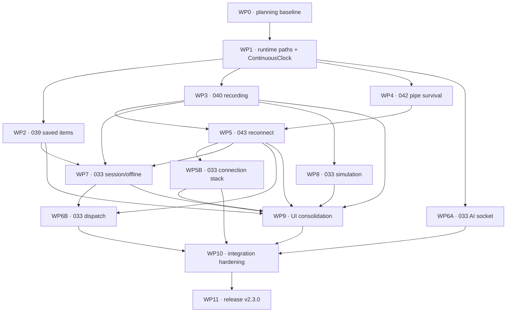

> **Planning snapshot (2026-09-03).** Release-completion and multi-agent worktree plan for
> TrailMate v2.3.0. The **epic files remain the source of truth**: [[033-refresh-test-coverage]],
> [[039-fix-saved-items-reorder]], [[040-per-session-recording]],
> [[042-survive-closed-daemon-pipe]], and [[043-auto-reconnect]]. This document freezes the
> cross-epic contracts, ownership boundaries, dependencies, and release sequence. If it disagrees
> with an epic, fix the drift here; do not silently reinterpret the epic. [[architecture]],
> [[features]], and [[decisions]] describe shipped/current behavior and are updated only as code lands.

# TrailMate v2.3.0 — Release Completion & Multi-Agent Plan

**Release theme:** correctness, connection robustness, and regression coverage.

**Included epics:**

- [[033-refresh-test-coverage]] — close deterministic coverage gaps left since v2.0.0.
- [[039-fix-saved-items-reorder]] — repair the flicker/snap-back defect for locations and routes.
- [[040-per-session-recording]] — split live capture per session from app-wide persistence.
- [[042-survive-closed-daemon-pipe]] — turn a daemon EPIPE/SIGPIPE crash into one session drop.
- [[043-auto-reconnect]] — retry an armed session after abnormal disconnect or wake.

**Explicitly not in this release:** [[014-readme-screenshots]], [[023-cli-mcp-shim]],
[[037-mkmapview-idle-cpu]], and [[041-telemetry-plane]]. They remain scheduled for v2.4.0. The
v2.3.0 work may add narrow testability seams, but it must not pull in the v2.4 map/telemetry rewrite.

**Repository shape:** Swift sources are flat under `TrailMate/*.swift` with one type per file;
unit tests are app-hosted Swift Testing suites under `TrailMateTests/`; UI tests share
`TrailMateUITests/TrailMateUITests.swift`. The Xcode project uses filesystem-synchronized groups,
so adding Swift files should not normally edit `project.pbxproj`.

---

## 1. Completion strategy

The release has three implementation lanes and one quality lane:

1. **Data correctness:** 039 repairs saved-item ordering; 040 gives every session an independent
   capture while keeping one app-wide recordings library.
2. **Connection resilience:** 042 makes pipe closure survivable; 043 layers deterministic retry
   policy on the recovered disconnect path.
3. **Testability foundation:** inject runtime paths and monotonic time so app-hosted tests never
   touch personal files and timing tests never wait 5–50 seconds.
4. **Release quality:** 033 fills the audited lifecycle, IPC, offline, simulation, persistence, and
   UI gaps after the domain APIs stabilize; its remaining environment-bound cases become an owned
   manual release checklist rather than untracked omissions.

Epic 033 is a release gate, not the parent of the four correctness epics. Each domain branch must
land its own acceptance tests. The 033 branches then cover shipped cross-cutting behavior that no
single domain epic owns.

The critical path is:

```text
planning baseline → shared test seams → 042 pipe survival → 043 reconnect
                 ├→ 039 saved-item fix ────────────────┐
                 └→ 040 recording isolation ──────────┼→ 033 integration coverage
                                                     └→ UI + manual + release gates
```

---

## 2. Frozen cross-epic contracts

Agents build against these contracts rather than inventing competing ownership models in their
worktrees.

### 2.1 Shared testability seams

| Boundary | Required architecture | Live behavior | Test behavior |
|---|---|---|---|
| Runtime files and sockets | Add an `AppRuntimePaths` value carrying saved-route, recording, tunnel-control, and AI-socket locations. Inject the relevant URL into each owner instead of resolving Application Support internally. | `AppRuntimePaths.live` produces the existing directory layout. | Each test owns one explicit temporary root and deletes only that root. |
| Monotonic time | Add a small type-erased elapsed-time/sleep seam whose live implementation is backed by Swift's `ContinuousClock`. | Recording timestamps, retry delays, and any newly covered scheduled behavior use monotonic elapsed time. | A manual clock advances deterministically; no test sleeps through real retry windows. |
| Defaults | Preserve the existing production keys but make saved-waypoint and UI-test defaults stores injectable. | Existing user preferences and saved locations continue to load without migration. | Unit/UI tests use unique suites and restore or destroy only their own data. |
| App graph | Extend existing initializers/factories narrowly as each domain needs them. | `TrailMateApp` still constructs one live `AppState` graph. | Tests inject stores, paths, clocks, routing/search fakes, process/pipe handles, and session factories. |

Only `AppRuntimePaths` and the `ContinuousClock`-backed time seam belong in the shared foundation
branch. Domain agents add their own focused protocols/initializers. Do not introduce a service
locator, global mutable test mode, or a second application state tree.

### 2.2 Saved-item ownership (039)

- One persisted order remains the source rendered by each list section throughout a drag.
- Locations gain a `SavedWaypointsStore(defaults:)` (or equivalently narrow store type) parallel to
  `SavedRoutesStore`; it preserves the current Codable keys and format.
- Routes continue to persist their UUID order through `order.json` under the injected route root.
- Reorder is within the current section only. Category assignment remains the supported way to move
  an item between sections.
- Drag must not trigger the row's normal action: no teleport for a location and no load for a route.
- The agent must diagnose whether the defect is identity, gesture arbitration, or source-of-truth
  churn before choosing the smallest fix; this plan does not preselect a view workaround.

### 2.3 Recording ownership and lifetime (040)

- Each `SimulationActor` owns exactly one `RecordingCapture`. It holds the active flag, point buffer,
  and count for that session; no live capture state remains in `AppState` or `RecordingsLibrary`.
- `RecordingCapture.start()` anchors one wall-clock `Date` and one `ContinuousClock.Instant`.
  Each point timestamp is `wallStart + monotonicElapsed`, sampled synchronously at emission.
- `RecordingsLibrary` is app-wide and owns only persisted GPX files plus index loading/deletion.
  Existing replay and export flows read through that persistence seam. Its base directory is
  injected from `AppRuntimePaths`.
- **Only explicit Stop persists.** App quit and session removal discard the active capture and create
  no file/index entry.
- Switching sessions keeps the former session's capture running but makes its recording state and
  count invisible until that session is selected again.
- Explicit device Disconnect, abnormal pipe/tunnel loss, and reconnect detach/replace only the
  backend. They retain the same `DeviceSession`, `SimulationActor`, and `RecordingCapture`, matching
  today's offline-simulation model. A retry must never create a second capture or persist the first.
- Capture append stays actor-local and performs no per-point MainActor hop.

### 2.4 Pipe failure and reconnect state machine (042 + 043)

- `DaemonBridge` centralizes all stdin writes behind one EPIPE-aware operation. SIGPIPE protection is
  installed at the narrowest reliable layer (per-fd and/or process-wide as 042 decides) before any
  write can terminate the process.
- EOF, daemon exit, `TUNNEL_DOWN`, and EPIPE converge on one idempotent teardown notification. One
  session fails once; the other sessions, menu bar, AI socket, and local simulation remain alive.
- `DeviceSession` exposes a single prompt-policy-aware `connectOnce` primitive. The existing
  user-initiated Connect flow may keep its startup policy, but each displayed auto-reconnect attempt
  invokes exactly one connection attempt—never the old nested three-attempt loop.
- A successful explicit Connect arms recovery. Explicit Disconnect and Cancel retry disarm it;
  exhaustion ends the current recovery window, so another explicit Connect is required. The
  Settings toggle gates automatic recovery and, while off, reproduces today's manual behavior.
  Abnormal drop and sleep/wake do not themselves disarm an enabled, armed session.
- **Five seconds is a post-failure delay.** After the triggering failure, wait 5 seconds before
  attempt 1. After each failed attempt 1–9, wait 5 seconds before the next attempt. Attempt 10 fails
  directly into ordinary disconnected state: no final delay and no attempt 11.
- Cancel during a delay cancels it immediately. Cancel during an in-flight attempt lets only that
  attempt settle, shows disabled `Cancelling…`, and schedules nothing afterward.
- Reconnect never silently expands authorization. It can reuse the already-authorized/live tunnel;
  if recovery would require a new admin prompt, settle disconnected and wait for explicit Connect.
- Retry state is session-owned. A fails/B stays connected, and selecting B does not mutate A's retry.
- Production sleep and retry delays use the shared `ContinuousClock` implementation; unit tests use
  the same state machine with a manual clock.

### 2.5 Coverage and release boundaries (033)

- Every deterministic acceptance behavior has a unit or UI test at its lowest stable seam.
- Hardware, macOS authorization/system UI, live MapKit network results, menu-bar query limitations,
  signing/notarization, and the production Sparkle update remain explicit manual/release checks.
- App-hosted and UI tests must not read or write the user's production defaults, saved routes,
  recordings, sockets, or tunnel-control files.
- Production source must not gain public mutable hooks solely for XCUITest. DEBUG launch fixtures
  may provide canned devices/sessions/routes and isolated stores, while normal unit tests use
  constructor injection.
- UI assertions follow the selected session. In particular, hidden background recording state and
  a non-selected session's reconnect state must not leak into the selected control surface.

---

## 3. Work packages

Sizes are relative: S ≈ half to one day, M ≈ one to three days, L ≈ three to six days. Each WP is a
branch-sized deliverable, not necessarily a permanently assigned agent. With fewer agents, reuse a
worktree after its current branch is integrated.

| WP / suggested branch | Epic | Scope and exclusive primary ownership | Depends on | Handoff gate | Size |
|---|---|---|---|---|---|
| **WP0 — release coordinator** `integration/v2.3.0` | all | Review and commit this planning baseline; record `BASE`; create worktrees; own shared-doc changes, merge conflict resolution, final versioning, release notes, and release execution. | none | Baseline commit hash, branch/worktree map, test-run lease, merge log. | S + ongoing |
| **WP1 — runtime isolation** `refactor/033-test-runtime` | 033 foundation | Add `AppRuntimePaths`, the `ContinuousClock`-backed monotonic seam, manual test clock, temporary-root/defaults helpers, and the DEBUG isolated UI-test process configuration. No saved-item, recording, pipe, retry, or user-visible behavior changes. | WP0 | Live paths/keys match today; isolation-helper tests; build-for-testing passes. | M |
| **WP2 — saved-item reorder** `fix/039-saved-item-reorder` | 039 | Reproduce and trace both location/route paths; implement the minimal ownership/identity/gesture fix; own saved-item stores, `LibraryOrder`, and the two sidebar sections; add isolated persistence compatibility tests. | WP1 | Epic 039 acceptance mapping; reliable focused drag UI candidate or recorded accessibility limitation for WP9. | M |
| **WP3 — per-session recording** `fix/040-session-recording` | 040 | Add `RecordingCapture` and `RecordingsLibrary`; migrate actor/session/AppState recording paths; preserve library replay/export/delete; implement selected-only visibility and discard rules. | WP1 | Manual-clock capture tests, temporary-root library reload tests, two-session isolation, quit/removal discard, no shared live recorder. | M–L |
| **WP4 — closed-pipe survival** `fix/042-daemon-pipe` | 042 | Add pipe/process injection, SIGPIPE protection, centralized safe writes, and idempotent failure delivery. Own `DaemonBridge` and only the minimal `DeviceSession` teardown seam. Do not add retry policy. | WP1 | Fake peer covers READY/reply/timeout/EOF/EPIPE/exit; app survives; A's pipe failure leaves B working. | M |
| **WP5 — auto-reconnect** `feat/043-auto-reconnect` | 043 | Start from integrated WP4. Factor `connectOnce`; implement armed/retry/cancel/wake state machine, observable UI status, Settings toggle, menu-bar wording, and localization. Reuse the same session/actor/capture. | WP4; integrate WP3 before cross-epic tests | Manual-clock tests for exact 10-attempt timing, success/reset, exhaustion, both cancel phases, no prompt, sleep/wake, and per-session isolation. | L |
| **WP5B — connection-stack coverage** `test/033-connection-stack` | 033 | After 042/043 stabilize the seams, cover `DeviceDiscoveryService` JSON parsing, `TunnelBroker` UDID-map selection/errors, and `DeviceSession` transitions for explicit disconnect, EPIPE/EOF/exit/tunnel-down, sleep/wake, cancellation, and A-fails/B-survives. | WP4 + WP5 | Parser and state-transition suites use fake process/tunnel inputs only; every connection-stack row in 033 is mapped. | M |
| **WP6A — AI socket harness** `test/033-ai-socket` | 033 | Inject the Unix-socket path and dispatcher; test create/unlink, `0700` directory, greeting, fragmented/multiple lines, oversized input, client close, stale socket, toggle, and stop/start epochs. Own `CommandServer`/`SocketPath`; avoid AppState dispatch changes. | WP1 | Temporary socket root only; lifecycle/framing suite passes repeatedly. | M |
| **WP6B — AI dispatch matrix** `test/033-ai-dispatch` | 033 | Expand dispatch coverage for DEVICES, ROUTE, PLAY, PAUSE, STOP, SEEK, CLEAR, CONNECT, DISCONNECT, failure codes, focus/idempotency, per-device status, and clean-recorded/noisy-wire behavior. | WP5 + WP7; reuse their fakes | Every command contract maps to positive/failure tests; no GUI selection theft. | M |
| **WP7 — session/offline workflows** `test/033-session-route` | 033 | Add AppState/session lifecycle and offline route/search/copy coverage with injected router/search and two fake devices. Cover add/remove/selection, joystick re-home, tuning seed/fan-out, name clearing, independent routes, offline build/play/stop/save, disconnect/re-attach. | WP2 + WP3 + WP5 integrated | Tests use temporary roots/defaults and no real MapKit/device; fakes are documented for WP6B/WP9. | L |
| **WP8 — simulation behavior** `test/033-simulation-loop` | 033 | After WP3 stabilizes the actor, cover disconnected-idle suppression, connected idle re-emission, 10 Hz active display cap, 2 Hz playback cap, Rejoin reset, and one >200 m/>10 s abort. Production edits limited to the agreed clock/snapshot observer seam. | WP3 + WP1 | Deterministic manual-clock tests; no long sleeps or v2.4 telemetry work. | M |
| **WP9 — UI/presentation consolidation** `test/033-ui-coverage` | 033 + release | Sole owner of final UI-test fixtures/file. Add two-device selection, offline route/play/save, recording visibility, reconnect/cancel, updater preference/command, and menu/Dock reachability. Extract and unit-test pure `MenuBarStatusFormatter` and `ActivationPolicyDecision` values while leaving AppKit/SwiftUI adapters thin. Try one saved-item drag path. | WP2 + WP3 + WP5 + WP5B + WP7 + WP8 | UI suite uses isolated defaults/runtime root and no live services; pure presenters cover status/policy combinations; tests map to epics. | L |
| **WP10 — integration hardening** `integration/v2.3.0` | all | Integrate in the order below; remove temporary seams; update `testing`, current architecture/features/risks, and epic checkboxes to match landed behavior; create/run the written manual plan. | WP2–WP9, including WP5B | Clean diff, full unit/UI runs, manual matrix, no production-data access, release-readiness report. | M |
| **WP11 — release cut** `release/v2.3.0` or coordinator branch | all | Bump `MARKETING_VERSION` from 2.2.0 to 2.3.0 and `CURRENT_PROJECT_VERSION` from 12 to the next unused build; prepare attributed release notes; run protected dry run; publish stable; validate DMG and Sparkle update; finish PM bookkeeping. | WP10 approved | Public signed/notarized v2.3.0, working stable appcast/update, five epics shipped, milestone closed, snapshots current. | S · owner/release credentials |

---

## 4. Dependency graph and execution waves



### Wave 0 — freeze a common base (serial)

1. The coordinator reviews and commits the currently uncommitted plan/epic changes.
2. Record the commit as `BASE`; no agent branches from the older `HEAD`.
3. WP1 lands on the integration branch. All first-wave domain worktrees branch from the integrated
   WP1 commit, not directly from `BASE`.

### Wave 1 — independent domain cores (four agents in parallel)

Launch WP2, WP3, WP4, and WP6A. Their primary files/domains are disjoint. Each branch builds and
runs its targeted tests with a unique DerivedData path.

Integration checkpoint A merges **WP2 → WP3 → WP4 → WP6A**, resolves initializer composition only
in the integration worktree, and runs the whole unit target.

### Wave 2 — connection policy and actor coverage (parallel)

- WP5 starts from checkpoint A so it sees both the safe-pipe teardown and actor-owned recording.
- WP8 starts from checkpoint A and owns only simulation timing/observation coverage.
- WP7 may draft cases/fakes, but its final implementation starts after WP5 is integrated.

Integration checkpoint B merges **WP5 → WP8** and proves that retry, recording, and simulation all
use the single time seam without changing actor identity during reconnect.

### Wave 3 — cross-cutting unit coverage (parallel where files permit)

WP5B and WP7 start from checkpoint B. They may run in parallel, but WP5B owns the connection-stack
files and WP7 owns AppState/offline-route behavior. WP6B rebases onto WP7 and completes command
dispatch using the stable session fakes. The coordinator merges **WP5B → WP7 → WP6B** and runs the
entire unit target.

### Wave 4 — UI and manual verification (serial GUI lane)

WP9 owns the UI test file and GUI automation session. Once it lands, WP10 runs the complete suite,
executes the manual device/system matrix, updates only current-behavior docs, and writes a
release-readiness report. No feature branch may be merged after this gate without rerunning the
affected unit, UI, and manual checks.

### Wave 5 — release (serial, credentialed)

WP11 performs version/build changes, protected workflow dry run, stable publication, Sparkle
validation, and post-publish project tracking. This is intentionally not parallelized.

---

## 5. Hot-file ownership and merge policy

Parallelism stops at shared mutable owners. The coordinator enforces this order:

| Hot file/domain | Ordered owner |
|---|---|
| `AppState.swift` | WP1 constructor/runtime composition → WP2 saved locations → WP3 recordings → WP5 reconnect projection → WP7 session/route seams → WP6B dispatch. |
| `DeviceSession.swift` | WP3 recording lifecycle → WP4 teardown seam → WP5 connection state machine → WP5B state tests/seams → WP7 route/session coverage seam. |
| `SimulationActor.swift` | WP3 recording capture first; WP8 later adds only timing/observation seams. WP5 may call existing attach/detach behavior but must not replace the actor. |
| `ContentView.swift` | WP2 saved sections → WP3 recording controls/list → WP5 reconnect controls/status. WP9 tests the integrated UI and avoids production-layout refactors. |
| `TrailMateApp.swift` / `UITestSupport.swift` | WP1 establishes isolated launch configuration; WP9 is the sole later editor. |
| `DaemonBridge.swift` | WP4 only. WP5 consumes its outcome through `DeviceSession`; it does not reopen pipe internals. |
| `DeviceDiscoveryService.swift` / `TunnelBroker.swift` | WP5B owns parser/selection test seams after WP5; no other coverage branch edits them. |
| `CommandServer.swift` / `SocketPath.swift` | WP6A only. WP6B owns dispatch behavior, not socket lifecycle. |
| `TrailMateUITests.swift` | WP9 only. Domain agents provide accessibility identifiers/fixtures as notes or narrowly agreed commits. |
| `Localizable.xcstrings` | WP5 owns reconnect strings during parallel work; other agents queue required keys for the coordinator. |
| Epic/docs files | WP2→039, WP3→040, WP4→042, WP5→043. WP10 alone updates 033, `testing`, architecture/features/risks, roadmap, and this release plan during integration. |
| `project.pbxproj` | WP11 version/build values only. Any earlier edit caused merely by adding a synchronized Swift file is a stop-and-review event. |

Rules:

- Feature agents do not merge into the integration branch, rewrite another agent's branch, or
  resolve a semantic conflict without the coordinator.
- A branch that must touch a later owner's hot file either waits for that predecessor or sends a
  minimal requested patch to the coordinator.
- Rebase dependent work on the named checkpoint before handoff. “Passed before another branch
  merged” is not a valid integration result.
- Preserve the repo's single-source-of-truth policy: no parallel arrays for saved order, no duplicate
  recording flags, and no second reconnect owner in AppState/UI.

---

## 6. Worktree setup and agent brief

The current plan edits are uncommitted. Worktrees created from the current `HEAD` will not include
them, so the coordinator must first create the reviewed WP0 baseline commit. This plan does not
authorize an agent to commit it implicitly.

Example setup after WP1 is integrated; replace `<FOUNDATION_COMMIT>` with the recorded hash:

```bash
git worktree add ../TrailMate-wt-039 -b fix/039-saved-item-reorder <FOUNDATION_COMMIT>
git worktree add ../TrailMate-wt-040 -b fix/040-session-recording <FOUNDATION_COMMIT>
git worktree add ../TrailMate-wt-042 -b fix/042-daemon-pipe <FOUNDATION_COMMIT>
git worktree add ../TrailMate-wt-ai-socket -b test/033-ai-socket <FOUNDATION_COMMIT>
```

Each worktree needs a unique DerivedData directory. `PythonResources/` is gitignored; symlink it
from the primary checkout into each worktree before building, using an explicit path that resolves
to the primary checkout's directory.

Every agent brief must say:

1. Read `CLAUDE.md`, this release plan, the owned epic, [[architecture]], and [[testing]].
2. Work only in the assigned worktree/branch and primary domain; preserve unrelated changes.
3. Implement the epic's behavior and tests, not just scaffolding. Use Swift Testing for new unit
   suites and the shared manual clock for time-dependent behavior.
4. Never read/write production Application Support, defaults, or sockets in tests; never invoke the
   real device lister, MapKit network, daemon, admin dialog, or GitHub feed.
5. Update only the owned epic while parallel work is active. Send current-doc changes as handoff
   notes for WP10 unless the code and doc ownership were explicitly assigned together.
6. Do not launch TrailMate or run app-hosted tests while the owner has a live TrailMate session.
7. Commit with Conventional Commits only after the coordinator/user has authorized that workflow.

An agent handoff is incomplete unless it includes:

- branch name, base commit, and ordered commit hashes (or a clear uncommitted diff statement);
- acceptance criteria mapped to exact test names;
- files changed, hot-file overlap, and any new API/fixture contract;
- exact build/test commands and outcomes, including retained `.xcresult` on failure;
- evidence that temporary roots/defaults were used and personal state was untouched;
- remaining device/UI/manual checks, assumptions, and known failures.

---

## 7. Build and test coordination

- Parallel agents may run `build-for-testing` with distinct `-derivedDataPath` values.
- Unit tests are app-hosted and UI tests launch the real bundle identifier. Only one agent at a time
  holds the **test-run lease** for `xcodebuild test`; no full/UI run happens while a personal
  TrailMate session is open.
- Domain branches run targeted tests before handoff. Checkpoints A/B and WP7/WP6B integration run
  the entire unit target. WP9/WP10 alone run the full UI suite.
- Use the documented ad-hoc signing overrides. A clean worktree must have `PythonResources/` present
  (normally through the deliberate symlink) before a test build.
- Every branch and checkpoint runs `git diff --check`. The coordinator also verifies that tests did
  not create/modify files under the production Application Support layout.
- Long timing sleeps are a test failure. Retry/recording/simulation tests advance the manual clock
  and explicitly yield until the expected state consumes that advancement.

Primary commands are maintained in [[testing]]. Use unique derived-data paths, for example:

```bash
xcodebuild build-for-testing -project TrailMate.xcodeproj -scheme TrailMate \
  -destination 'platform=macOS' -derivedDataPath /tmp/TrailMate-DD-<WP> \
  CODE_SIGN_STYLE=Manual CODE_SIGN_IDENTITY=- CODE_SIGNING_REQUIRED=NO

xcodebuild test -project TrailMate.xcodeproj -scheme TrailMate \
  -destination 'platform=macOS' -derivedDataPath /tmp/TrailMate-DD-integration \
  CODE_SIGN_STYLE=Manual CODE_SIGN_IDENTITY=- CODE_SIGNING_REQUIRED=NO
```

---

## 8. v2.3.0 release gates

### Automated gate

- All acceptance tests added by 039, 040, 042, and 043 pass.
- Every deterministic row in 033's coverage-gap matrix is covered or has an explicit, documented
  technical reason it belongs in the manual gate.
- Full unit and UI suites pass from the integrated release candidate using isolated runtime state.
- The CI build/test/UI-test jobs pass, and any failed `.xcresult` is inspected rather than rerun away.
- No test or fixture touches personal defaults, saved routes, recordings, AI socket, or tunnel files.
- `git diff --check` passes; no unexpected package/project changes or v2.4 feature code are present.

### Manual functional gate

Run the permanent checklist written at `TrailMateTests/ManualSmokeTestPlan.md`, including:

1. Saved locations and routes reorder without flicker in ungrouped and populated category sections;
   drop does not teleport/load; order survives category round-trip and relaunch.
2. Two devices record concurrently into disjoint files. Switching selection hides/reveals the
   correct live capture. Explicit Stop saves; app quit and session removal discard without an index
   entry. Abnormal disconnect/reconnect preserves the same active capture without duplication.
3. Pull USB or otherwise close one daemon pipe: TrailMate stays alive, that session shows the error,
   the other session keeps running, and the AI socket/menu bar remain available.
4. Reconnect timing/state: 5-second initial post-failure delay, ten single attempts, correct success,
   exhaustion, Cancel retry, `Cancelling…`, explicit Disconnect disarm, and no unexpected admin
   prompt. Repeat sleep/wake under the same policy.
5. Existing offline route, joystick, search, recording replay/export/delete, multi-session selection,
   menu-bar, updater settings, and no-orphan-on-quit checks remain green.
6. Live MapKit search/road routing, real USB/Wi-Fi discovery, authorization, map-control occlusion,
   and MenuBarExtra status are checked on the supported environment because CI cannot prove them.

### Packaging and update gate

1. With all code/tests accepted, bump `MARKETING_VERSION` to `2.3.0` and the build number to the next
   unused value (13 if no intervening build consumed it).
2. Prepare user-visible release notes covering the four fixes and coverage hardening, with the
   repository-required generated-text attribution.
3. Run `release.yml` with `dry_run=true`; inspect the signed/notarized DMG, mounted app deep-signature
   verification, Gatekeeper assessment, appcast, and update archive artifacts.
4. Install the dry-run/manual artifact on a clean test account and rerun the critical functional
   smoke matrix.
5. Publish stable from `main` with `dry_run=false` and `beta=false` only after the dry run and owner
   sign-off. Validate the GitHub Release assets and deployed Pages appcast.
6. Starting from stable v2.2.0, run the production Sparkle path through discovery, download,
   signature verification, install, and relaunch into v2.3.0. Confirm the manual DMG remains usable.

### Post-publish gate

- Verify the tag/version/build and release assets, and retain the release-readiness evidence.
- Set all five epic files to `status: done` with the ship date; close the matching GitHub issues and
  v2.3.0 milestone according to [[playbook]].
- Refresh roadmap/backlog static snapshots and user-facing “current stable” documentation.
- Triage release findings as new epics; do not reopen already shipped epics.

---

## 9. Stop conditions

An agent stops and reports to the coordinator instead of inventing a worktree-local workaround when:

- completing the WP requires redesigning another active agent's primary domain;
- a seam creates a second source of truth for session, recording, saved order, or retry state;
- reconnect would replace the session/actor, duplicate/discard a recording, or request authorization
  without an explicit Connect;
- a test passes only by touching production state, calling a live service, or sleeping in real time;
- the fake protocol no longer matches the production flow documented in current architecture;
- an unexpected `project.pbxproj`, dependency, persistence migration, or user-visible behavior change
  is required;
- a v2.4 map/telemetry/CLI/screenshots concern is discovered. Record it for that release and keep
  v2.3 focused unless it blocks a v2.3 acceptance criterion.

---

## 10. Definition of release complete

v2.3.0 is complete only when all five epic acceptance lists are satisfied; deterministic gaps from
033 are automated; the remaining manual matrix is executed and recorded; the integrated code passes
CI; the Developer ID-signed, notarized stable DMG is public; the Sparkle update from v2.2.0 succeeds;
and release tracking is closed. “All branches merged” is feature-complete, not release-complete.
